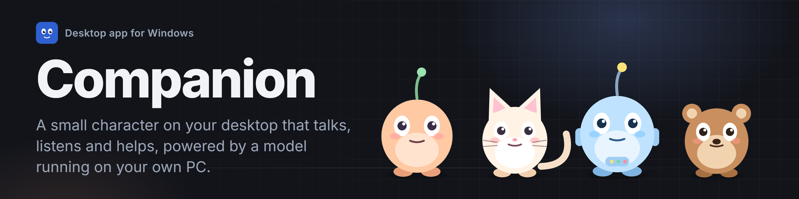
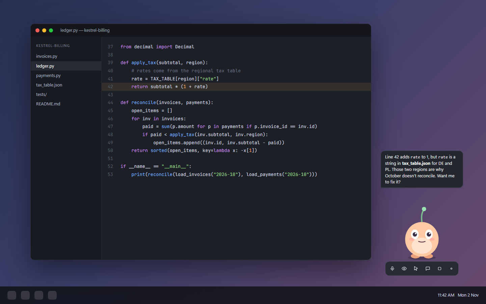
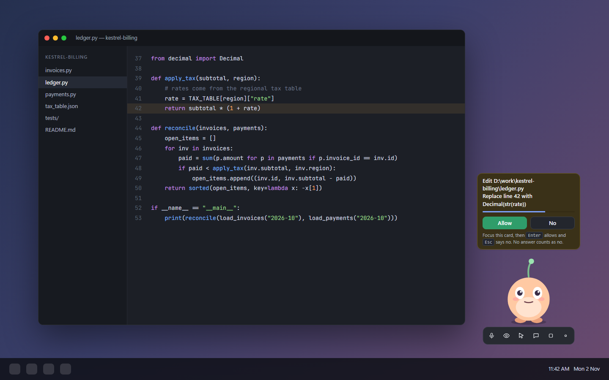
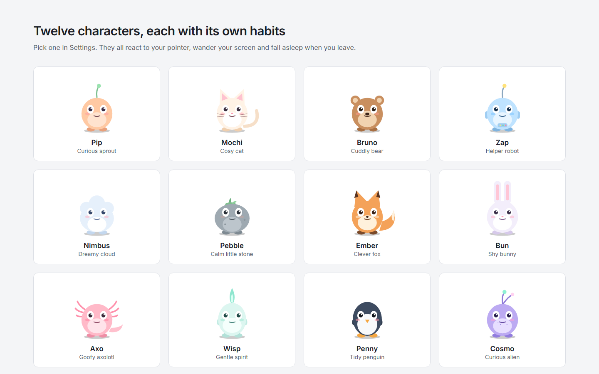

<picture>
  
</picture>

[](https://github.com/anand34577/companion/actions/workflows/build.yml)


Companion is a Windows desktop app. A small animated character lives on your screen, listens when you talk, can look at
what you're doing, and answers out loud. The language model runs on your own graphics card through llama.cpp, so nothing
you say or show leaves the machine.

<p align="center"></p>

A [11-second clip](assets/companion-promo.mp4) (1080×1080 MP4) is included for sharing on X and LinkedIn.

## Why

Most assistants live in a browser tab and only know what you paste into them. Companion sits next to your work, sees the
screen when you let it, and can act on it with your approval. The model is small enough (about 1.4 GB) to run on a
mid-range GPU, and everything stays local.

## Features

- Talks and listens. It hears your voice directly (tone and language, not just a transcript) and starts speaking before
  the full reply is written.
- Sees your screen when you turn that on, and shows what it's doing in a thought bubble ("Looking at your screen").
- Controls the mouse, keyboard, files and shell, only when computer control is on, and asks before anything risky.
- Remembers facts you tell it, sets reminders and timers, reads web pages.
- Connects to your own MCP servers (local programs over stdio, or HTTP endpoints).
- Comes with 12 original characters, each with its own voice, habits and reactions.
- Keeps secrets in Windows Credential Manager, not in the settings file.

<p align="center"></p>

## Quick start

1. Download the latest installer (`Companion_*_x64-setup.exe`) from the [Releases](https://github.com/anand34577/companion/releases) page and run it.
2. Open **Settings** from the tray icon. On first launch it opens by itself.
3. In **Setup**, press *Download model* (about 1.4 GB, resumable, checksum-verified), pick your graphics card, then
   press *Save & wake me up*.

llama.cpp is already inside the installer. You should see your character appear and say hello. The
[Getting started](https://github.com/anand34577/companion/wiki/Getting-Started) wiki page walks through each step.

## Build from source

You need Windows 10 or 11, Node.js 22, the stable Rust toolchain and PowerShell.

```powershell
npm install
npm run fetch:llama     # downloads the pinned llama.cpp (Vulkan) into src-tauri/resources/llama, checksum-verified
npm run dev
```

`npm run build` produces the NSIS and MSI installers under `src-tauri/target/release/bundle/`.

## Releases

Pushing a tag that starts with `v` runs the [build workflow](.github/workflows/build.yml): clippy and tests, then a
Windows build, then a GitHub Release with the `.exe` installer, the `.msi` installer and a `SHA256SUMS.txt` attached.

```bash
git tag v0.1.1 && git push origin v0.1.1
```

Bump the version in `package.json`, `src-tauri/Cargo.toml` and `src-tauri/tauri.conf.json` first, and add a line to
[CHANGELOG.md](CHANGELOG.md).

## llama.cpp is bundled and pinned

| File | Purpose |
|---|---|
| `llama.cpp.version` | The exact llama.cpp release tag that gets bundled (currently `b12038`). |
| `llama.cpp.sha256` | SHA-256 of that release's `llama-<tag>-bin-win-vulkan-x64.zip`. The download is rejected if it differs. |
| `scripts/fetch-llama.ps1` | Downloads, verifies and unpacks it into `src-tauri/resources/llama`. |
| `.github/workflows/build.yml` | CI: clippy and tests, then fetches that same pinned version and builds the installer with it bundled. |

The app uses, in order: the llama-server you chose in Settings, the bundled one, then `llama-server` on PATH.

**Updating llama.cpp:** change `llama.cpp.version` and `llama.cpp.sha256` together in one commit (the checksum is shown
as the release asset's `digest` on GitHub), run `npm run fetch:llama -- -Force`, and test before merging. LFM3-Omni needs
a build at or after llama.cpp PR #31257 (`b12038` includes it).

## What it can do

- **Talk and listen** (voice) or **type** (`Ctrl+Alt+C`, or double-click the character). Settings -> Voice & sight lets you
  pick the microphone and speaker (with a live level meter, chime and voice test), set the volume, mute spoken replies,
  choose the language you speak, and switch to **push to talk** (hold `Ctrl+Shift+Space`; pressing it while I talk
  interrupts me). Unplug a headset and I switch to another device and tell you.
- **Hearing and speaking use LFM3-Omni's own abilities.** I hear your actual voice (tone, mood, language), not just a
  transcript; I speak as the first audio is generated (streaming); each character has a stable voice of their own (made
  once and kept in `voices/`), and you can try another voice or give me a recording of a voice you have permission to use.
  Every reply starts with a hidden mood ([happy], [curious], ...) that changes my expression.
- **Voice activity detection** (high-pass filter, adaptive noise floor, hysteresis, hiss rejection) with a visible state:
  a small badge shows when I'm listening and when I hear you speak.
- **Manners:** I stay perfectly still while thinking, talking or being typed to; I keep off your text caret, the spot
  you last clicked and your pointer when it rests on me; and *Playfulness* (quiet / normal / lively) sets how jokey I am.
- **Chat history** for the current session (Settings -> Chat). It is kept in memory only.
- **Show what I'm doing:** a thought bubble while thinking (with the current step, e.g. "Looking at your screen"), and
  the reply streams into a speech bubble as I write it.
- **Built-in tools:** screen view, memory, reminders and timers, date/time, system info, read web pages. With
  *computer control* on: mouse and keyboard, read/list/write files, run commands, clipboard, open links.
- **MCP servers:** add your own in Settings -> Tools (local program over stdio, or an HTTP endpoint). Their tools appear
  to the model as `mcp_<server>_<tool>`.
- **12 original characters** (Pip, Mochi, Bruno, Zap, Nimbus, Pebble, Ember, Bun, Axo, Wisp, Penny, Cosmo), each with its
  own temperament, idle habits and reactions. Eyes follow your pointer; poke them, pick them up, let them sleep.
- **Roaming area:** draw a rectangle on your screen (Settings -> Character) to keep me inside it; otherwise I roam anywhere.

<p align="center"></p>

## Safety

- Computer control starts **off** every launch. Risky actions need an on-screen *Allow*.
- Settings -> Safety: *Ask for risky things* (default; includes pressing Enter, which may send something), *Ask for
  everything*, or *Full access* (never ask; a warning is shown once before it can be enabled). The approval card shows
  a countdown; no answer counts as no.
- Web pages I read are checked at the address they really resolve to (redirects included), so a link can't point me at
  this PC or your network unless full access is on.
- Tokens for connectors and MCP servers are stored in Windows Credential Manager, not in `settings.json`.
- The model download is pinned to a fixed revision and its SHA-256 is verified.
- `Ctrl+Alt+Space` stops everything instantly. The model server listens on a random local port with a per-launch key.

## Tests

```powershell
cd src-tauri
cargo test
cargo clippy --all-targets
```

## More

The [wiki](https://github.com/anand34577/companion/wiki) covers installation, every setting, troubleshooting and how
the app is put together. The same pages live in [docs/wiki](docs/wiki).

## Contributing

Issues and pull requests are welcome. See [CONTRIBUTING.md](CONTRIBUTING.md).

## License

Companion is released under the [Apache License 2.0](LICENSE). You can use, modify and redistribute it, including in
commercial work, as long as you keep the license and [NOTICE](NOTICE) and state your changes. The software comes with no
warranty. The bundled llama.cpp is MIT-licensed, and the LFM3-Omni model that the app downloads is under LiquidAI's own
license (see [NOTICE](NOTICE)).
