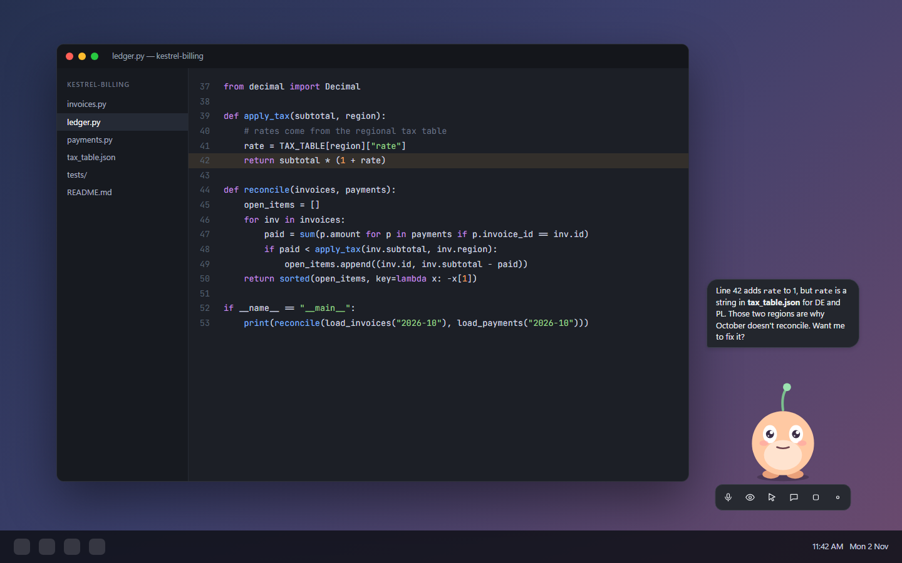

This takes about ten minutes, most of it the model download.

### 1. Open Settings

On first launch the Settings window opens by itself. If you closed it, right-click the tray icon and choose Settings, or press the gear button on the character's toolbar.

### 2. Check the engine

Step 1 on the **Setup** tab should show a green banner saying llama.cpp is built in. If it doesn't, see [Troubleshooting](Troubleshooting#the-engine-step-is-red).

### 3. Download the model

Press **Download model** in step 2. Two files come down (about 1.10 GB and 0.29 GB) from LiquidAI's Hugging Face repository. The download resumes if it's interrupted, and each file's SHA-256 is checked at the end. Both rows should turn green.

### 4. Pick your graphics card

In step 3, choose the card to run the model on. If you have an integrated and a dedicated GPU, choose the dedicated one.

### 5. Wake the character

Press **Save & wake me up**. The first start loads the model into memory, which takes a while. A small pill below the character shows progress. When it finishes, the character says hello.

### 6. Say something

Talk to it, or press `Ctrl+Alt+C` and type. To ask about your screen, turn on the eye button in the toolbar first.

What next: [Using Nuzzle](Usage) for everything it can do, and [Safety and privacy](Safety) before you turn on computer control.
