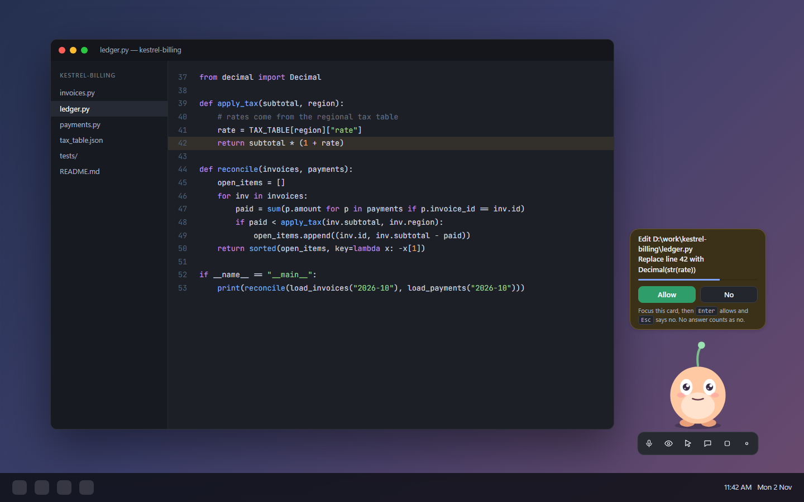
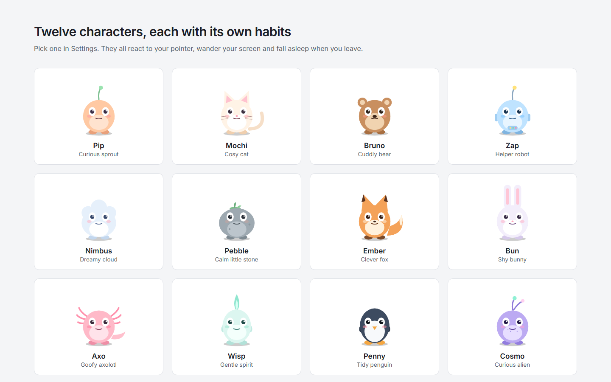

## Talking and typing

- **Voice:** speak while the microphone button on the toolbar is on. A small badge shows when it's listening and when it hears you.
- **Push to talk:** turn it on in *Voice & sight*, then hold `Ctrl+Shift+Space` while you speak. Pressing it while the character is talking interrupts it.
- **Typing:** `Ctrl+Alt+C`, or double-click the character.
- **Stop everything:** `Ctrl+Alt+Space` stops speech, tools and any running action at once.

## Quick commands

A message that starts with a slash is done at once, without the model. These work before a model is downloaded, while
it is loading, in the typing box, in Settings -> Chat, from Telegram and through the agent API.

| Command | What it does |
|---|---|
| `/timer 10m tea` | A timer (`90s`, `25`, `1h30m` and `25 minutes` all work; a bare number is minutes). |
| `/remind 3pm call mum` | A reminder at a clock time, or after a while (`/remind in 2 hours ...`). |
| `/remind every 1h drink water` | A repeating reminder (`every day at 9am ...` works too). |
| `/reminders`, `/cancel tea` | List reminders, or cancel the ones containing a word. |
| `/note buy milk`, `/notes` | Add a line to *Quick notes* in Documents/Nuzzle Notes, or list your notes. |
| `/calc 19.99 * 3` | Exact arithmetic. |
| `/convert 5 km to miles` | Length, weight, volume, time, data size, speed, area and temperature. |
| `/flip`, `/roll 2d6`, `/pick tea, coffee` | A coin, dice, or a fair choice. |
| `/remember I like green tea` | Save a fact to long-term memory. |
| `/today`, `/weather Pune` | Today's reminders and weather (the morning hello on demand), or a forecast. `/weather` alone uses your town from Settings -> Character. |
| `/time`, `/new`, `/stop`, `/help` | The time, a fresh chat (the model forgets this conversation), stop everything, this list. |

Anything else you type goes to the model as before, including text that merely starts with a slash, such as a file path.

## The toolbar

Hover over the character to show it. From left to right: microphone, screen viewing, computer control, type a message, stop, settings, hide to tray. Computer control is off every time the app starts.

## What it can do for you

| Tool | Needs computer control? | Example |
|---|---|---|
| Look at the screen | No (needs screen viewing) | "What does this error mean?" |
| Memory | No | "Remember that my invoices go out on the 28th." |
| Reminders and timers | No | "Remind me to stretch in 20 minutes." "Remind me to drink water every hour." |
| Unit conversion, coin, dice, picks | No | "How many cups is 500 ml?" "Pick one: pizza or pasta." |
| Date, time, system info | No | "How much memory is free?" |
| Read web pages | No | "Summarise this link." |
| Mouse, keyboard, scrolling | Yes | "Click the Export button." |
| Read, list and write files | Yes | "Open ledger.py and look at line 42." |
| Run commands | Yes | "Run the tests." |
| Clipboard, open links | Yes | "Copy that to the clipboard." |

Risky actions show an approval card. It counts down, and no answer counts as no.

## Characters

Pick one in Settings, *Character*. Each has its own voice, idle habits and replies when you poke it. You can also draw a rectangle on screen to keep the character inside it.

## MCP servers

In *Tools*, add a server either as a local program (command and arguments, talking over stdio) or as an HTTP endpoint. Its tools show up to the model as `mcp_<server>_<tool>`. Tokens you enter are stored in Windows Credential Manager.
